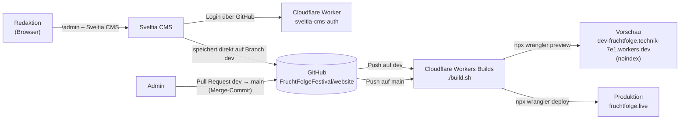

# Fruchtfolge Festival – Webseite

Die Webseite des **Fruchtfolgefestival Förderfreunde e.V.**: ein kleines Stoner-, Psych- und Punk-Rock-Festival auf dem Acker in Lindach bei Fürstenfeldbruck.

| | Adresse |
|---|---|
| **Live-Seite** | <https://fruchtfolge.live> (bis zum DNS-Umzug: <https://fruchtfolge.technik-7e1.workers.dev>) |
| **Vorschau** (Branch `dev`, nicht für Suchmaschinen) | <https://dev-fruchtfolge.technik-7e1.workers.dev> |
| **Redaktion (CMS)** | <https://fruchtfolge.live/admin> |
| **Technik-Kontakt** | technik@fruchtfolge.live |

## Ich will etwas ändern

- **Texte, Termine, Line-up, Fotos, News:** im CMS unter `/admin`. Schritt-für-Schritt-Anleitung: **[docs/redaktion.md](docs/redaktion.md)**.
- **Veröffentlichen:** Das dürfen nur die Admins. Die Redaktion speichert auf `dev` (Vorschau) und gibt einem Admin Bescheid. Der Admin übernimmt die Änderungen per Pull Request `dev → main`.
- **Technik, Konten, Störungen:** [docs/betrieb.md](docs/betrieb.md).

## So hängt alles zusammen



- **Hugo** (statischer Seitengenerator) baut aus Markdown/YAML fertige HTML-Seiten.
- **Cloudflare Workers mit Static Assets** liefern die Seite aus. Es gibt keinen eigenen Server-Code, nur `wrangler.jsonc`.
- **Sveltia CMS** ist eine Redaktionsoberfläche im Browser. Sie schreibt Änderungen als Git-Commits ins Repository.
- **Datenschutz:** Die öffentliche Seite lädt nichts von fremden Servern (keine Google Fonts, kein Tracking, keine Einbettungen). Deshalb braucht sie kein Cookie-Banner.

## Wichtigste Befehle

Voraussetzungen: [Hugo extended](https://gohugo.io/installation/) in der Version aus `.hugo-version` (zurzeit 0.170.1) und Node.js 24 (nur für Wrangler).

| Befehl | Wozu |
|---|---|
| `hugo server -D` | Lokale Entwicklung mit Live-Neuladen unter <http://localhost:1313> (inkl. Entwürfe, Vorschau-Banner und Design-Werkstatt) |
| `./build.sh` | Baut wie Cloudflare. Ohne Angabe wird der aktuelle Git-Branch genommen. |
| `BUILD_BRANCH=main ./build.sh` | Baut wie die Produktion. Bricht ab, solange die Datenschutzerklärung ein Entwurf ist. |
| `npm ci` | Installiert Wrangler (einmalig) |
| `npx wrangler dev` | Liefert `public/` lokal genauso aus wie Cloudflare (inkl. `_redirects`, `_headers`, 404-Seite) |

## Verzeichnisse

```text
.
├── content/            Seiten als Markdown (Startseite, Über uns, Rechtstexte …)
│   ├── festivals/      ein Jahrgang pro Datei (2025.md, 2026.md, 2027.md)
│   └── news/           Neuigkeiten
├── data/               strukturierte Daten (Einstellungen, Design-Farben, ABC, Presse, Sponsoring, Ländercodes)
├── assets/
│   ├── css/            main.css (Design), farben.css (Farben aus data/design.yaml), werkstatt.css (nur Vorschau)
│   ├── js/             theme.js, site.js (Menü, Hell/Dunkel, Lightbox), werkstatt.js (nur Vorschau)
│   └── images/         Logo und alle hochgeladenen Bilder (werden von Hugo verkleinert)
├── layouts/            eigenes Hugo-Theme (Templates)
├── static/             wird 1:1 ausgeliefert: Schriften, Favicons, PDFs, _headers, _redirects
│   └── admin/          Sveltia CMS (index.html, config.yml, sveltia-cms.js)
├── archiv-alt/         Originaldaten der alten WordPress-Seite (wird NICHT ausgeliefert)
├── docs/               Dokumentation
├── werkzeuge/          Hilfsskripte (z. B. Lade-Logo aus einem SVGator-Export aufbereiten)
├── build.sh            Build-Skript für Cloudflare und lokal
├── wrangler.jsonc      Cloudflare-Konfiguration
├── hugo.toml           Hugo-Konfiguration und Menüs
├── .hugo-version       die gepinnte Hugo-Version
└── AGENTS.md           Regeln für KI-Agents (CLAUDE.md verweist darauf)
```

## Dokumentation

| Datei | Für wen | Inhalt |
|---|---|---|
| [docs/redaktion.md](docs/redaktion.md) | Redaktion | Anmelden, Inhalte ändern, Vorschau, Veröffentlichen |
| [docs/cms-aufgaben.md](docs/cms-aufgaben.md) | Redaktion | Was im CMS noch fehlt oder überarbeitet werden muss |
| [docs/betrieb.md](docs/betrieb.md) | Admins | Konten, Cloudflare-Einstellungen, DNS, Updates, Störungen |
| [docs/einrichtung.md](docs/einrichtung.md) | Admins | Einmalige Ersteinrichtung als Checkliste |
| [docs/entscheidungen.md](docs/entscheidungen.md) | alle Technik-Leute | Warum die Technik so ist, wie sie ist |
| [docs/datenschutz-checkliste.md](docs/datenschutz-checkliste.md) | Vorstand, Admins | Welche Dienste Daten berühren |
| [docs/migration.md](docs/migration.md) | Admins | Umzug von WordPress, offene Inhalts-Punkte |
| [AGENTS.md](AGENTS.md) | KI-Agents | Regeln und Definition of Done |

## Lizenzen

- Schriften: SIL Open Font License 1.1 (Lizenztexte in `static/fonts/`)
- Sveltia CMS: MIT-Lizenz (`static/admin/sveltia-cms-LICENSE.txt`)
- Inhalte, Fotos und Logos: © Fruchtfolgefestival Förderfreunde e.V. bzw. die genannten Fotograf:innen und Bands
